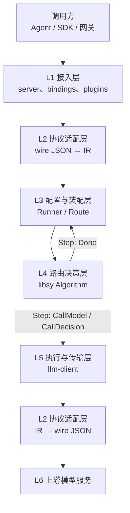
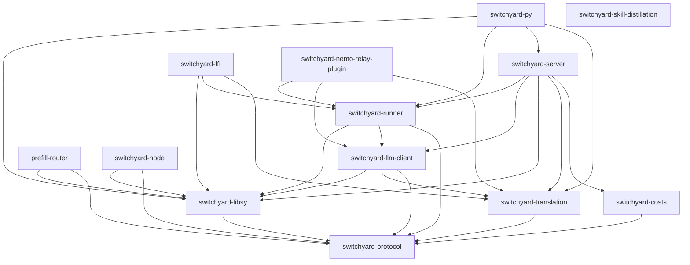

# Switchyard 项目结构总览

本文面向维护者，说明三件事：

- 顶层目录各放什么。
- 一条请求沿纵向经过哪些层。
- 各入口共用的能力在横向上如何分组。

纵向看请求路径，横向看公共组件。两者结合，可以看到每个 crate 的职责和边界。

本文是维护者视角的架构说明，不列入 MkDocs 导航。产品文档从 `docs/index.md` 开始。

## 1. 核心架构判断

Switchyard 把两件事分开：

1. **路由决策**：选哪个模型，是否需要先问分类器或裁判模型。
2. **模型调用**：真正发 HTTP 请求，处理凭据、重试、流式响应。

`switchyard-libsy` 只做第 1 件事。它定义 `Algorithm` 和 `Step`，把模型调用交给宿主。宿主可以用 `switchyard-llm-client`，也可以自己实现客户端。

这个边界决定了整个仓库的分层：

- 越靠近 `libsy`，代码越纯，越容易测试。
- 越靠近服务入口，代码越多地处理 HTTP、配置、日志和部署。

## 2. 顶层目录

| 目录 | 内容 | 说明 |
|---|---|---|
| `crates/` | Rust workspace 的主要 crate | 产品代码集中在这里 |
| `bindings/go/` | Go 绑定 | 默认走 WASM，也可走 C ABI |
| `bindings/typescript/` | TypeScript 包 | 包装 `switchyard-node` |
| `switchyard/` | 公开 Python 包 `switchyard` | 薄封装，导出 `switchyard_rust` 的能力 |
| `switchyard_rust/` | Python 原生扩展的包装与类型存根 | 对应 `crates/switchyard-py` |
| `examples/` | 集成示例 | Claude Code、LiteLLM、Dynamo PreProc、pi、Prometheus |
| `docs/` | MkDocs 文档源 | 产品文档、协议、算法、运维说明 |
| `tests/` | Python 测试 | 覆盖 Python API、文档示例和端到端流程 |
| `benchmark/` | 基准测试资产 | 路由配置、服务端配置、数据集和对比脚本 |
| `scripts/` | 开发与发布脚本 | 发布、基准图、soak 测试 |
| `dev-server/` | 内部开发服务器部署 | systemd 单元和示例 TOML |
| `experimental/` | 实验性项目 | `craft-taskgen`、`switchyard-desktop` |
| `assets/` | 图片和基准图 | README 与文档使用 |
| `.github/` | CI 与协作模板 | 测试、发布、文档、Go 绑定等 workflow |
| `.cargo/` | workspace Cargo 配置 | 编译参数 |
| `.hooks/` | Git hook 脚本 | 例如自动补 SPDX 头 |
| `.agents/`、`.claude/` | 本地 agent 配置与技能 | 开发辅助 |

根目录的 `Cargo.toml` 是 Rust workspace 清单。`pyproject.toml` 使用 maturin 构建 Python wheel。`mkdocs.yml` 定义文档导航。`Dockerfile` 构建 `switchyard-server` 镜像。

## 3. 纵向分层：一条请求怎么走

### 3.1 分层图



这张图描述的是完整的 HTTP serving 路径。嵌入式宿主可以跳过 L1 和 L3，直接使用 L4。无论从哪一层进入，L4 都用同一套 `Step` 协议请求外部工作。

### 3.2 L1 接入层

接入层负责把外部请求变成统一的 `switchyard_protocol::Request`。它处理 HTTP 细节、鉴权、请求体限制和响应格式。

主要入口：

- `switchyard-server`：Axum HTTP 服务器。`build_switchyard_router` 注册全部端点，`build_llm_router` 只注册三个推理端点，便于嵌入其他应用。
- `switchyard-py` 的 `server_bindings.rs`：在 Python 进程内启动 loopback 服务器。
- `switchyard-nemo-relay-plugin`：NeMo Relay 原生插件，拦截 Relay 的 LLM 调用。
- `switchyard-ffi`：C ABI 与 WASI 导出，供 Go 绑定使用。
- `switchyard-node`：Node.js NAPI 绑定，当前暴露 Composite 路由。
- `switchyard-py` 的 `libsy_bindings.rs`：Python 直接驱动 libsy 的 `Step` 流。

三个推理端点对应三种 wire format：

| 端点 | wire format |
|---|---|
| `POST /v1/chat/completions` | `openai_chat` |
| `POST /v1/messages` | `anthropic_messages` |
| `POST /v1/responses` | `openai_responses` |

`switchyard-server` 还提供路由决策和运维端点：

| 端点 | 用途 |
|---|---|
| `POST /v1/decision` | 只做路由决策，不执行最终模型调用 |
| `POST /v1/messages/count_tokens` | 转发 Anthropic token 计数 |
| `POST /v1/responses/input_tokens` | 转发 OpenAI Responses token 计数 |
| `POST /v1/responses/compact` | 转发 Responses 压缩操作 |
| `GET /v1/models` | 列出已配置路由和模型能力 |
| `GET /v1/stats`、`POST /v1/stats/reset` | 进程内统计 |
| `GET /metrics` | Prometheus 指标 |
| `GET /health` | 健康检查 |
| `GET /v1/routing/session-stats` | 开启 routing log 后查询会话统计 |
| 未匹配路径 | 有 `fallback_client` 时反向代理到上游 |

### 3.3 L2 协议适配层

这一层把供应商 JSON 和统一中间表示（IR）互相转换。

- **入口方向**：`switchyard-translation` 解码请求，得到 `LlmRequest`，再包成 `Request`。
- **出口方向**：`switchyard-translation` 把 `LlmResponse` 编码回调用方原来的格式。
- **上游方向**：`switchyard-llm-client` 把 IR 编码成目标模型的 wire format，收到响应后再解码回 IR。

核心类型在 `switchyard-protocol`：

- `Request`：`LlmRequest` + 原始请求体 + `Metadata`。
- `Response`：`LlmResponse` + `Metadata` + 上游响应头。
- `LlmRequest`：消息、指令、工具、采样参数、reasoning 等。
- `LlmResponse`：聚合响应或流式响应。
- `WireFormat`：`openai_chat`、`anthropic_messages`、`openai_responses`。

`switchyard-translation` 用 codec 注册表实现双向转换：

- `FormatRegistry` 管缓冲编解码器。
- `StreamCodecRegistry` 管流式编解码器。
- 三种格式各有 `buffered` 和 `stream` 实现。
- `TranslationPolicy` 决定有损转换时如何处理。
- `TranslationDiagnostic` 记录转换中的信息、警告和错误。

这一层只做数据转换。它不发 HTTP，也不读环境变量。

### 3.4 L3 配置与装配层

这一层把部署配置变成可执行的 `Route`。

`switchyard-runner` 解析 TOML，主要 section 如下：

```toml
schema_version = 1
fallback_client = "optional_upstream"

[llm_clients.<name>]        # 上游 HTTP 客户端
[targets.<name>]            # 模型 ID + 客户端 + 额外请求体
[decision_clients.<name>]   # 决策模型客户端
[decision_targets.<name>]   # 决策目标
[routes.<name>]             # 对外暴露的路由模型 + 算法配置
```

装配结果：

- `Runner`：不可变的命名路由表。`Runner::load` 读取文件并校验；`Runner::route` 按模型名查找。
- `Route`：一个算法实例 + 每个目标的客户端 + 能力声明 + 决策目标 + 辅助操作目标。
- `RunOutput`：选中模型和响应。
- `DecisionDescription`：只返回选中目标、fallback 目标和元数据，供 `/v1/decision` 使用。

两种使用方式：

- `Runner`：完整装配，包含 HTTP 客户端和凭据。
- `AlgorithmFactory`：只解析 TOML 并构建算法，由宿主自己执行模型调用。Python 绑定使用这条路径；Go 绑定通过 FFI 使用 `AlgorithmSpec`，同样由宿主执行调用。

`switchyard-runner` 还负责：

- 校验配置中的目标名和算法参数。
- 读取 `api_key_env` 指定的环境变量。
- 支持 caller auth forwarding。
- 把错误分成可重试、上下文超限、配置错误等类别（`failure.rs`）。

### 3.5 L4 路由决策层

`switchyard-libsy` 是路由核心。主要入口是 `Algorithm::run_stream`。

运行时对象：

- `Algorithm`：路由策略。`route` 方法返回 `RoutingOutcome`。
- `Driver`：算法请求外部工作的句柄。提供 `call_model`、`call_decision`、`models_for` 等。
- `Step`：算法和宿主之间的消息。
  - `CallModel`：请求一次或多次候选模型调用。
  - `CallDecision`：请求一次类型化决策调用。
  - `Done`：路由完成，携带 `RoutingOutcome`。
- `RuntimeModels`：按 `Category` 分组的模型池，例如 `Capable`、`Efficient`、`Judge`、`Any`。
- `State`：跨请求保留的会话状态。
- `OutcomeMetadata`：算法名、证据、裁判记录和 outcome ID。

`run_stream` 做四件事：

1. 创建独立的 `Driver`。
2. 在 Tokio task 中运行算法。
3. 把 `Step` 放进容量为 1 的通道，让算法跟着消费者节奏前进。
4. 算法结束或 panic 时，保证发出一个终止项。

`drive` 是配套的执行循环。它并发执行 `CallModel` 和 `CallDecision`，直到收到 `Done`。宿主也可以不用 `drive`，自己消费 `run_stream`。

算法分组：

| 分组 | 算法 | 主要用途 |
|---|---|---|
| 简单策略 | `Noop`、`Passthrough`、`Random` | 不选模型、固定模型、随机选择 |
| 任务分类 | `LlmTaskClassifier`、`LlmClassifier` | 先判断任务难度，再选强或弱模型；包含升级和降级判定配置 |
| 执行信号 | `StageRouter`、`CompositeRouter`、`AdvisorGate`、`PlanExecute`、`Vgr` | 根据工具调用、失败、计划、验证信号调整模型 |
| 多 agent | `SubagentRouter`、`AffinityRouter` | 按会话、子 agent、亲和性保持或切换模型 |
| 基础设施 | `InfraPolicy` | 根据队列和负载信号调整选择 |

内部还有 `FallThrough` 组合框架和 `escalation` 辅助模块，用来实现分类器级联和升级判定。

共享工具在 `crates/libsy/src/algorithms/util/`：分类器契约、LLM 裁判、prompt 拼接、工具信号、tier 评分、target 选择、transcript 处理等。

`libsy` 不做网络 I/O。它只通过 `Driver` 请求工作，通过 `Step` 交付结果。

### 3.6 L5 执行与传输层

`switchyard-llm-client` 是 `run_stream` 的现成消费者，也是 HTTP 传输层。

核心入口：

- `run()`：驱动算法直到 `RoutingOutcome`，然后按需执行最终模型调用。
- `decide()`：只完成路由阶段的调用，不执行最终模型调用。
- `ClientRouter`：按模型名找客户端。支持一个客户端服务全部模型，也支持每个模型一个客户端。
- `TranslatingLlmClient`：编码 IR、发 HTTP、解码响应。
- `Backend`：固定 wire format、URL 路径和鉴权方式。
- `SystemOneClient`：处理类型化决策请求。

`run()` 的步骤：

1. 如果请求带有已记录的 Responses 状态，走 `continue_on`，把继续请求交给原供应商。
2. 否则调用 `libsy::drive`，并通过 `serve` 执行每个 `Step`。
3. `serve` 根据调用中的目标模型找到客户端，准备目标专属请求，然后执行调用。
4. 算法返回 `RoutingOutcome`。
5. 如果 outcome 已带 `response`，直接使用。
6. 否则用 `call_first_available` 按 `selected_model_ids` 顺序调用。
7. 候选失败时，根据错误类型决定是否前进到下一个候选。
8. 记录 Responses 状态归属。
9. 对需要观察答案的算法调用 `observe_answer`。

候选 fallback 的规则：

- 上下文窗口超限时，尝试下一个候选。
- 传输失败、上游明确暂时不可用、超时、403、429 和 5xx 时，尝试下一个候选。
- 内容策略拒绝时，只有存在 `fallback_request` 才继续尝试；否则直接返回。
- 客户端配置了 `fallback_on_rate_limit = false` 时，429 直接返回。
- 其他错误直接返回。

传输层的细节：

- 后端重试预算：`max_retries`、`failure_cooldown`、`timeout`。
- 请求准备：目标 prompt、`extra_body`、`omit_body_fields`、reasoning 设置。
- 鉴权：静态 API key 或转发调用方凭据。
- 请求头：白名单转发，去掉 hop-by-hop 头和连接相关头。
- 流式响应：解码 SSE，转换成统一的 `LlmResponseChunk`。
- 辅助操作：Anthropic `count_tokens`、Responses `input_tokens` 和 `compact`。

### 3.7 一条 HTTP 请求的完整路径

以 `switchyard-server` 的 `POST /v1/chat/completions` 为例：

1. Axum 路由进入 `openai_chat_completions`。
2. 中间件记录开始时间，限制请求体大小。
3. `handle_endpoint_inner` 从请求头构造 `Metadata`，包括 session ID 和 correlation ID。
4. `resolve_route` 调用 `observed_translation::decode_request`，把 JSON 解码成 `LlmRequest`。
5. 从 `LlmRequest.model` 得到路由 ID，在 `Runner` 中查找 `Route`。找不到返回 404。
6. 检查 caller auth 格式和声明的模型能力。不支持的输入返回 400。
7. 构造 `Request { llm_request, raw_request, metadata }`。
8. `Route::execute` 调用 `switchyard_llm_client::run`。
9. `run` 调用 `libsy::drive`。
10. `libsy` 启动算法，算法通过 `Step` 请求分类器、裁判或模型调用。
11. `run` 的 `serve` 把每次调用交给 `ClientRouter` 和 `TranslatingLlmClient`。
12. 客户端编码请求、发 HTTP、解码响应。
13. 算法返回 `RoutingOutcome`。
14. 如果没有现成答案，`run` 按候选顺序执行最终模型调用。
15. `Route` 返回 `RunOutput`。
16. 服务器把 IR 响应编码回请求的 wire format，转发允许的上游响应头，并加上选中模型响应头。
17. 服务器记录统计、routing log 和 usage；响应中间件对输出做脱敏。
18. 流式响应走 SSE，缓冲响应走普通 JSON。

### 3.8 不同入口的差异

| 入口 | 使用 `Runner` / `Route` | 谁执行模型调用 | 典型路径 |
|---|---|---|---|
| `switchyard-server` | 是 | `switchyard-llm-client` 的 HTTP 客户端 | 完整 HTTP → libsy → HTTP |
| Python `Server` | 是 | 内嵌的 `switchyard-server` | Python 启动 loopback 服务 |
| Python `libsy` | 否，可选 `AlgorithmFactory` | Python 宿主 | Python 驱动 `Step` |
| Go 绑定 | 否，算法来自 JSON 配置 | Go 宿主回调 | Go → WASM/C ABI → libsy |
| TypeScript/Node | 否 | 调用方 | TS → NAPI → Composite |
| NeMo Relay 插件 | 是 | `switchyard-llm-client` | Relay 拦截 → Runner → 上游 |
| Claude Code 插件 | 是 | 原生分类器 + Claude 登录 | 决策服务 → `decide_with_client` |
| Dynamo PreProc | 是 | 不调用模型，只选模型 | ExtProc → `Runner.decide` |
| LiteLLM 插件 | 否 | LiteLLM | Python 插件 → libsy `Step` |

## 4. 横向分组：公共组件

### 4.1 公共组件总表

| 能力 | 主要位置 | 被谁使用 |
|---|---|---|
| 协议类型 | `crates/protocol` | 所有 crate |
| 格式翻译 | `crates/switchyard-translation` | 服务器、客户端、Relay、Python、Go |
| 可观测性 | 各 crate 的 `observability.rs`、`metrics.rs` | 服务器、客户端、libsy、Relay |
| 成本与定价 | `crates/switchyard-costs` | 服务器 routing log |
| 脱敏与安全 | `server/redaction.rs`、`runner/provider_key_redactor.rs` | 服务器、Relay |
| 配置 | `runner/config.rs`、`runner/algorithm.rs` | 服务器、Relay、Python、Go |
| 会话状态 | `libsy/core/state.rs`、`protocol/metadata.rs` | 算法、服务器、Dynamo |
| 测试与基准 | crate 内测试、`tests/`、`benchmark/` | 开发与发布 |

### 4.2 协议类型

`switchyard-protocol` 是各层共用的数据契约。它不依赖 workspace 里的其他 crate。

模块：

- `envelope.rs`：`Request`、`Response`。
- `llm.rs`：`LlmRequest`、消息、内容块、工具、采样参数。
- `stream.rs`：流式响应事件和聚合器。
- `decision.rs`：类型化决策请求和响应。
- `client.rs`：`RoutedLlmClient`、`RoutedDecisionClient`、`LlmClientError`。
- `metadata.rs`：session、agent、correlation 等元数据。
- `category.rs`：模型分类。
- `model_id.rs`：模型 ID。
- `format.rs`：`WireFormat` 和 `FormatId`。
- `infra.rs`：基础设施信号。
- `codex_namespaces.rs`：Codex 命名空间相关类型。

`client.rs` 里的两个 trait 是宿主扩展点：

- `RoutedLlmClient::call`：执行一次模型调用。
- `RoutedDecisionClient::call`：执行一次决策调用。

### 4.3 格式翻译

`switchyard-translation` 是纯 Rust 库。在 workspace 内，它只依赖 `switchyard-protocol`。

模块：

- `engine.rs`：`TranslationEngine`、`FormatRegistry`。
- `codecs/openai_chat/`：Chat Completions 的缓冲和流式编解码。
- `codecs/anthropic/`：Anthropic Messages 的缓冲和流式编解码。
- `codecs/responses/`：OpenAI Responses 的缓冲和流式编解码。
- `codecs/common.rs`、`codecs/stream.rs`：公共逻辑和流式注册表。
- `codecs/openai_media.rs`、`codecs/structured_output.rs`：媒体和结构化输出处理。
- `policy.rs`：转换策略。
- `diagnostic.rs`：转换诊断。
- `util.rs`、`helpers.rs`：请求准备、工具 ID 规范化、保留字段处理。
- `codex_namespaces.rs`、`codex_custom_tools.rs`：Codex 兼容处理。
- `sse.rs`：SSE 解析。

### 4.4 可观测性

各层使用同一条 OpenTelemetry 思路，但职责不同。

`libsy`：

- `libsy.run` span：一次路由。
- `libsy.llm_call` span：一次模型调用。
- `libsy.decision_call` span：一次决策调用。
- 指标：调用次数、耗时、结果、outcome、选中模型。
- 不安装 exporter，不做网络上报。

`switchyard-llm-client`：

- `libsy.client_call` span：一次候选调用。
- 记录候选序号、候选总数、调用阶段、选中模型。
- `RunObserver` 把 outcome、routing call、answer call、routing overhead 交给宿主。

`switchyard-server`：

- `observability.rs`：初始化 tracing 和 OTLP。
- `metrics.rs`：Prometheus registry 和 `/metrics`。
- `stats/`：进程内统计和缓存命中探测。
- `usage_metrics.rs`：token 使用量。
- `routing_log.rs`：可选 JSONL 持久化记录。

`switchyard-nemo-relay-plugin`：

- `span_capture.rs`：把路由过程转换成 Relay 的 span。
- `runtime.rs`：把结果转成 Relay 的 mark 和 metric。

### 4.5 成本、日志与统计

`switchyard-costs` 维护模型价格表，并按 `Usage` 计算请求成本。

- 支持按模型 ID 查价。
- 支持分组价格文件。
- 未知模型或未知用量保持未知，不虚构价格。
- 服务器可用 `--pricing-file` 替换内置价格表。
- `--routing-log-file` 打开持久化路由记录后，价格用于记录成本。

### 4.6 安全与脱敏

主要机制：

- **凭据来源**：`api_key_env` 从环境变量读取密钥；`forward_auth` 转发调用方凭据。
- **凭据族校验**：转发凭据时，目标必须和调用方格式兼容。
- **调试输出脱敏**：`HttpBackendConfig` 的 `Debug` 隐藏 API key。
- **响应脱敏**：服务器和 Relay 使用 provider key redactor 清理输出。
- **请求头白名单**：服务器只转发允许的上游响应头。
- **能力拒绝**：路由声明 `tool_calling = false`、`vision = false` 或 `reasoning = false` 时，服务器拒绝对应输入。
- **请求体限制**：`DEFAULT_MAX_REQUEST_BODY_BYTES`。
- **TLS**：服务器支持证书和私钥启动 HTTPS。

### 4.7 配置

配置分三种形态：

- **TOML**：`switchyard-runner` 的部署配置，服务器和 Relay 使用。
- **Python 对象**：Python 绑定用构造函数配置算法。
- **JSON**：Go 和 TypeScript 绑定用 JSON 描述算法和目标。

TOML 的核心对象：

- `DeploymentConfig`：整个文件。
- `LlmClientConfig`：上游客户端，包括格式、URL、鉴权、重试和额外字段。
- `TargetConfig`：模型 ID 和所属客户端。
- `DecisionClientConfig`、`DecisionTargetConfig`：决策模型。
- `RouteConfig`：对外模型 ID、能力声明、基础设施策略和 `AlgorithmSpec`。

`AlgorithmSpec` 在 `runner/algorithm.rs`，为每种算法定义配置结构。它负责把 TOML 转成 `libsy` 的配置类型。

### 4.8 状态与会话

会话信息从 `Metadata` 进入：

- `session_id`：会话标识。
- `agent_id`：子 agent 标识。
- `is_subagent`：是否子 agent。
- `session_final`：会话是否结束。
- `correlation_id`：日志关联 ID。

`libsy::State` 保存跨请求状态：

- 工具信号。
- 目标 prompt。
- 算法自定义值，例如 tier 保持计数、fallback 状态。

与会话相关的其他机制：

- `AffinityRouter`：按会话或消息哈希保持模型。
- `SubagentRouter`：父 agent 和子 agent 使用不同的模型组。
- `ClientRouter` 的 state owner：保存 Responses 的 `previous_response_id`、`conversation` 和跨格式历史。
- 服务器 routing log：按 session 聚合统计。

### 4.9 测试与基准

- Rust 单元测试：各 crate 内的 `mod tests` 和 `tests/` 子目录。
- Python 测试：`tests/`，包括 getting started、e2e、relay plugin 打包。
- Go 测试：`bindings/go/*_test.go`，覆盖 WASM 和 native 两种后端。
- TypeScript 测试：`bindings/typescript/test/`。
- 基准资产：`benchmark/`，包括 routing profile、server config、数据集准备和报告脚本。
- 压测工具：`switchyard-soak`，向运行中的服务器发持续负载。

## 5. Crate 依赖与模块地图

### 5.1 依赖方向



依赖方向从接入层指向协议层。`protocol` 不依赖任何 workspace crate。`switchyard-skill-distillation` 是独立的契约 crate，不在这条请求路径上。

### 5.2 核心 crate

| crate | package | 职责 | 关键模块 |
|---|---|---|---|
| `crates/protocol` | `switchyard-protocol` | 统一请求、响应、流、决策和客户端 trait | `envelope`、`llm`、`stream`、`decision`、`client` |
| `crates/switchyard-translation` | `switchyard-translation` | 三种 wire format 与 IR 的双向转换 | `engine`、`codecs/*`、`policy` |
| `crates/libsy` | `switchyard-libsy` | 路由算法和 `Step` 执行协议 | `core/algorithm`、`core/classifier`、`algorithms/*` |
| `crates/libsy-llm-client` | `switchyard-llm-client` | 驱动 `run_stream`，执行 HTTP 模型调用 | `run`、`client`、`backend`、`system_one` |
| `crates/switchyard-runner` | `switchyard-runner` | TOML 配置、目标解析、Route 装配 | `config`、`algorithm`、`route`、`runner` |
| `crates/switchyard-server` | `switchyard-server` | HTTP 服务、端点、运维能力 | `lib`、`sse`、`response`、`stats`、`routing_log` |

### 5.3 绑定与集成

| crate / 目录 | 形式 | 说明 |
|---|---|---|
| `crates/switchyard-py` | PyO3 | `_switchyard_rust` 扩展，包含 libsy、server、translation 子模块 |
| `crates/switchyard-node` | NAPI | `NativeComposite`，暴露 Composite 路由和决策调用 |
| `crates/switchyard-ffi` | C ABI / WASI | `SyRouter`、`SyRun`、回调和 JSON 协议；Go 的底层 |
| `bindings/go` | Go module | WASM（wazero）或 native 两种后端 |
| `bindings/typescript` | npm 包 | 包装 `switchyard-node` 的 TS 接口 |
| `crates/switchyard-nemo-relay-plugin` | NeMo Relay 原生插件 | 加载 Switchyard TOML，拦截 buffered/stream 调用 |
| `examples/claude` | Rust 二进制 + Claude Code 插件 | 用 `Runner` 和原生分类器选择 Sonnet/Opus |
| `examples/litellm` | Python 包 | LiteLLM 路由插件，支持 Stage 和 Random |
| `examples/dynamo-preproc` | Rust ExtProc 服务 | 只选择模型，把结果交给 Dynamo EPP |
| `examples/pi` | TypeScript | pi agent 的路由示例 |

### 5.4 支撑 crate

| crate | 职责 |
|---|---|
| `crates/prefill-router` | 基于 checkpoint 的预填充路由算法，作为可选 feature 接入 runner/server |
| `crates/switchyard-costs` | 模型价格表和成本计算 |
| `crates/switchyard-skill-distillation` | 轨迹转技能的数据契约和异步端口，当前不参与请求路径 |
| `crates/switchyard-soak` | 对运行中的服务器做持续负载测试 |

## 6. 设计边界

理解以下边界，可以快速判断代码应该放在哪里。

1. **决策和 I/O 分开**。`libsy` 不持有 HTTP 客户端、密钥或重试策略。宿主通过 `Driver` 提供这些能力。
2. **协议层不依赖上层**。`switchyard-protocol` 是最底层，任何 crate 都可以依赖它。
3. **翻译层保持纯函数**。`switchyard-translation` 只接收 `Value` 和 IR，返回 IR 或 `Value`。网络、配置和遥测放在上层。
4. **runner 是可选的**。嵌入式宿主可以只用 `libsy`，不需要 TOML 或 `Runner`。
5. **server 是参考服务**。项目文档把 `switchyard-server` 定位为本地演示和评估入口。生产部署由使用方自己的网关或服务承担。
6. **绑定只暴露宿主需要的部分**。Python 暴露完整 `Step` 流；Go 暴露 C ABI 和算法配置；Node/TS 只暴露 Composite。
7. **集成复用 runner**。NeMo Relay、Claude 插件和 Dynamo PreProc 共用同一套 TOML、客户端和算法装配，避免出现第二套配置语言。

## 7. 修改入口对照表

| 想改什么 | 先看哪里 |
|---|---|
| 新增路由算法 | `crates/libsy/src/algorithms/`，再在 `lib.rs` 导出 |
| 改算法配置字段 | `crates/switchyard-runner/src/algorithm.rs` |
| 改 TOML 结构 | `crates/switchyard-runner/src/config.rs` |
| 改上游请求编码 | `crates/switchyard-translation/src/codecs/` |
| 改 HTTP 调用、重试、鉴权 | `crates/libsy-llm-client/src/client.rs`、`backend.rs` |
| 改候选 fallback 规则 | `crates/libsy-llm-client/src/run.rs` |
| 新增 HTTP 端点 | `crates/switchyard-server/src/lib.rs` |
| 改流式响应 | `crates/switchyard-server/src/sse.rs`、`crates/switchyard-translation/src/codecs/*/stream.rs` |
| 改指标、日志、成本 | `crates/switchyard-server/src/metrics.rs`、`stats/`、`routing_log.rs`、`crates/switchyard-costs/` |
| 改 Python API | `crates/switchyard-py/src/` 和 `switchyard_rust/` |
| 改 Go API | `bindings/go/` 和 `crates/switchyard-ffi/src/lib.rs` |
| 改 NeMo Relay 行为 | `crates/switchyard-nemo-relay-plugin/src/runtime.rs` |

## 8. 推荐阅读顺序

1. 先读 `docs/mechanics_of_libsy.md`，理解 `Step` 和 `RoutingOutcome`。
2. 再读 `crates/libsy/src/core/algorithm.rs`，看 `Algorithm`、`Driver`、`drive`。
3. 然后读 `crates/libsy-llm-client/src/run.rs`，看现成的宿主如何执行调用。
4. 接着读 `crates/switchyard-runner/src/config.rs` 和 `route.rs`，看 TOML 如何变成 `Route`。
5. 最后读 `crates/switchyard-server/src/lib.rs`，看 HTTP 请求如何接入整条链路。
6. 需要扩展语言或网关时，再读对应的绑定或集成目录。

## 9. 构建和运行
### 编译构建：
cargo build --locked --release -p switchyard-server

### 使用：
mac：
export NVIDIA_API_KEY="xxx"
./target/release/switchyard-server --config dev-server/config.toml --host 127.0.0.1 --port 4000 --routing-log-file logs/routing.jsonl

windows：
.\target\release\switchyard-server.exe --config dev-server\config.toml --host 127.0.0.1 --port 4000 --routing-log-file logs\routing.jsonl

### 健康检查：
curl http://127.0.0.1:4000/health
curl http://127.0.0.1:4000/v1/models

### 请求：
curl -i http://127.0.0.1:4000/v1/chat/completions \
    -H 'content-type: application/json' \
    -d '{"model":"switchyard/qlc","messages":[{"role":"user","content":"hello"}]}'

指定session-id:
curl -i http://127.0.0.1:4000/v1/chat/completions \
    -H 'content-type: application/json' \
    -H 'x-switchyard-session-id: demo' \
    -d '{"model":"switchyard/qlc","messages":[{"role":"user","content":"hello"}]}'

决策接口：
curl -i http://127.0.0.1:4000/v1/decision \
    -H 'content-type: application/json' \
    -d '{
      "input_format": "openai_chat",
      "request": {
        "model": "switchyard/qlc",
        "messages":[
          {"role":"user", "content":"hello"}
        ]
      }
      }'